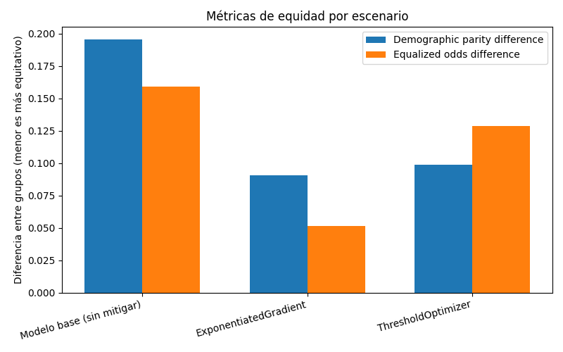

# Evidencias — Auditoría de equidad, mitigación y explicabilidad

_Generado automáticamente el 2026-10-17 05:13._

## Configuración de la corrida

- **Dataset:** data/job_applicants_limpio.csv
- **Columna objetivo:** `Employed` (clase positiva: `1`)
- **Atributo sensible:** `Gender`
- **Método de mitigación:** `ambos`
- **Restricción de equidad:** `demographic_parity`

## Auditoría de equidad — modelo base (pre-mitigación)

- **Exactitud global:** 0.788
- **Demographic parity difference:** 0.195
- **Equalized odds difference:** 0.159
- **demographic_parity_ratio:** 0.630
- **equalized_odds_ratio:** 0.351

### Métricas por grupo

| Grupo | Exactitud | Tasa de selección |
|---|---|---|
| Man | 0.790 | 0.529 |
| NonBinary | 0.792 | 0.333 |
| Woman | 0.761 | 0.472 |

### Interpretación (consigna 8.d, vinculada con la consigna 3)

El modelo base alcanza una exactitud global de 0,788, pero su comportamiento no es homogéneo entre géneros. La tasa de selección (proporción de postulantes que el modelo predice como contratados) es de 52,9 % para hombres, 47,2 % para mujeres y 33,3 % para personas no binarias. La *demographic parity difference* de 0,195 corresponde a la brecha entre hombres y personas no binarias (19,6 puntos porcentuales), y el *demographic parity ratio* de 0,630 indica que el grupo menos favorecido recibe solo el 63 % de las predicciones positivas del grupo más favorecido, por debajo del umbral de 0,80 de la regla de los cuatro quintos. En el caso de las mujeres, el cociente frente a los hombres es de 0,89 (0,472 / 0,529): no cruza ese umbral, pero muestra una desventaja sistemática de 5,7 puntos. Además, el modelo es menos exacto con las mujeres (0,761 frente a 0,790 en hombres), es decir, se equivoca más con ellas, y la *equalized odds difference* de 0,159 indica que las tasas de verdaderos o falsos positivos difieren hasta 16 puntos entre grupos.

**Vínculo con el caso Amazon.** El patrón es consistente con lo documentado por Dastin (2018) en la dirección del sesgo: el grupo masculino mayoritario es el más favorecido y la desventaja crece a medida que el grupo está menos representado en los datos (sobre 73.462 registros: hombres 93,3 %, mujeres 4,8 %, personas no binarias 1,9 %). Esto ilustra el sesgo de representación analizado en la consigna 3: con pocos ejemplos de un grupo, el modelo toma como estándar de éxito el perfil mayoritario y comete más errores con el resto.

También refleja el sesgo de etiqueta, ya que `Employed` registra decisiones de contratación históricas. En el dataset completo, la tasa real de contratación es de 54,1 % para hombres, 44,9 % para mujeres (cociente 0,83, en el límite de la regla de los cuatro quintos) y 53,3 % para personas no binarias. En el conjunto de test, la tasa real es de 53,9 % para hombres, 48,6 % para mujeres y 45,8 % para personas no binarias. Al comparar estas tasas con las predichas surgen dos comportamientos distintos:

- **Mujeres:** el modelo reproduce la brecha histórica. La diferencia real con los hombres es de 5,3 puntos y la predicha es de 5,7. Es decir, aprende y perpetúa el sesgo presente en las etiquetas, el mismo mecanismo que en Amazon.
- **Personas no binarias:** el modelo amplifica la brecha. La diferencia real con los hombres es de 8,1 puntos, pero la predicha llega a 19,6, más del doble. El grupo menos representado es el que el modelo penaliza más allá de lo que muestran los propios datos.

La magnitud de la disparidad contra las mujeres es menor que la reportada en Amazon, lo cual es esperable: aquí el modelo trabaja sobre variables tabulares de perfil y no sobre el texto libre de los CV, donde operaban proxies léxicos como "women's".

**Limitación.** El conjunto de test incluye solo 142 mujeres y 48 personas no binarias sobre 3.000 casos (en el grupo no binario, cada persona equivale a 2 puntos porcentuales), por lo que las métricas de esos grupos tienen alta variabilidad y deben leerse como indicios, no como estimaciones precisas.

## Comparación antes / después de la mitigación

| Escenario | Exactitud | Demographic parity diff. | Equalized odds diff. |
|---|---|---|---|
| Modelo base (sin mitigar) | 0.788 | 0.195 | 0.159 |
| ExponentiatedGradient | 0.788 | 0.068 | 0.093 |
| ThresholdOptimizer | 0.791 | 0.091 | 0.109 |

### Corrida complementaria: restricción `equalized_odds`

Misma configuración, cambiando solo `FAIRNESS_CONSTRAINT=equalized_odds` (el modelo base es idéntico porque la semilla es fija):

| Escenario | Exactitud | Demographic parity diff. | Equalized odds diff. |
|---|---|---|---|
| Modelo base (sin mitigar) | 0.788 | 0.195 | 0.159 |
| ExponentiatedGradient | 0.783 | 0.091 | 0.052 |
| ThresholdOptimizer | 0.776 | 0.099 | 0.129 |

### Interpretación (consigna 9.c)

**Efectividad.** Con la restricción de paridad demográfica (corrida principal), ambas técnicas redujeron las dos métricas de disparidad sin costo en exactitud. ExponentiatedGradient bajó la DPD de 0,195 a 0,068 (−65 %) y la EOD de 0,159 a 0,093 (−42 %), y mantuvo la exactitud en 0,788. ThresholdOptimizer llevó la DPD a 0,091 (−53 %) y la EOD a 0,109 (−31 %), con una exactitud de 0,791. En la corrida complementaria con *equalized odds*, ExponentiatedGradient obtuvo la menor EOD de todo el experimento (0,052, −67 %) con una pérdida de exactitud de apenas 0,5 puntos. ThresholdOptimizer, en cambio, casi no logró reducir su propia métrica objetivo (EOD 0,129, −19 %) y fue el escenario con menor exactitud (0,776). En conjunto, ExponentiatedGradient resultó la técnica más efectiva en ambas configuraciones, y el costo en exactitud fue marginal (1,2 puntos como máximo): en este caso, ganar equidad no exigió sacrificar desempeño de forma significativa.

**Tensión entre definiciones de equidad.** Cada restricción optimiza mejor su propia métrica. Con *demographic parity* se obtiene la menor DPD (0,068), pero la EOD queda en 0,093; con *equalized odds* se obtiene la menor EOD (0,052), pero la DPD queda en 0,091. Ninguna configuración minimiza ambas a la vez, lo que confirma que las definiciones de equidad no son equivalentes y que elegir cuál priorizar es una decisión normativa, no solo técnica. En un sistema de selección como el de Amazon, priorizar *equalized odds* significa exigir que candidatas y candidatos igualmente calificados tengan la misma probabilidad de ser recomendados, que es justamente la falla documentada en la consigna 3; el resultado respalda la mejora 2 propuesta en la consigna 6.

**Limitaciones observadas.**

- La disparidad no desaparece: en el mejor de los casos persiste una brecha de entre 5 y 9 puntos.
- ThresholdOptimizer necesita conocer el género de cada postulante al momento de decidir, porque aplica un umbral distinto por grupo. En un proceso de contratación esto implica un trato diferenciado explícito por género, jurídicamente cuestionable (consigna 5).
- El bajo rendimiento de ThresholdOptimizer con *equalized odds* probablemente se debe al tamaño reducido de los grupos minoritarios: los umbrales por grupo se estiman con pocos ejemplos y no generalizan bien al conjunto de test.
- La mitigación corrige las predicciones, pero no la etiqueta: `Employed` sigue reflejando decisiones históricas, de modo que *equalized odds* iguala las tasas de error respecto de una "verdad" que puede estar sesgada.
- Los resultados provienen de una única partición train/test sobre una muestra de 10.000 filas y no tienen intervalos de confianza: con otra semilla, las cifras de los grupos pequeños podrían variar.

## Explicabilidad (SHAP) — modelo base

SHAP se aplica siempre sobre el modelo base, antes de cualquier mitigación: el objetivo es ver qué técnica de auditoría preventiva podría haber detectado el problema antes del despliegue (consigna 4).

### Predicción 23 — el atributo sensible más influyó

- Contribución absoluta de `Gender`: 0.806
- Predicción del modelo: 0 · Valor real: 0

### Predicción 0 — el atributo sensible casi no influyó

- Contribución absoluta de `Gender`: 0.048
- Predicción del modelo: 1 · Valor real: 1

### Resumen global

### Interpretación (consigna 10, vinculada con la consigna 4)

**Resumen global.** La variable que más influye en las predicciones es, por amplio margen, `ComputerSkills` (cantidad de tecnologías que maneja el postulante), seguida de `PreviousSalary`, `Country_United States of America` y `YearsCodePro`. Las columnas de género aparecen recién entre las posiciones 13 y 15, con contribuciones pequeñas: a nivel global, el modelo decide principalmente por competencias. Sin embargo, el signo de esas contribuciones no es neutro. Ser una persona no binaria (`Gender_NonBinary = 1`) empuja sistemáticamente la predicción hacia "no contratado" (≈ −0,55 en log-odds). Para las mujeres, en cambio, el efecto directo se compensa: `Gender_Woman = 1` suma levemente (≈ +0,3), pero `Gender_Man = 0` resta en una magnitud similar (≈ −0,2).

**Predicción 23 (el género más influyó).** Corresponde a una persona no binaria que el modelo predice como no contratada, en coincidencia con el valor real. El género le resta en total 0,81 en log-odds (−0,57 por `Gender_NonBinary` y −0,22 por `Gender_Man = 0`), lo que equivale a multiplicar sus chances de ser contratada por 0,45 aproximadamente. En este caso la penalización no cambia la decisión, porque el factor dominante es su bajo nivel de `ComputerSkills` (−3,21). Pero el mismo descuento aplicado a un postulante cercano al umbral sí podría invertir el resultado: es exactamente el tipo de discriminación que una auditoría preventiva debe detectar.

**Predicción 0 (el género casi no influyó).** Corresponde a un hombre, del grupo mayoritario, que el modelo predice correctamente como contratado. La contribución del género es de apenas 0,048 y ni siquiera aparece entre las nueve variables más influyentes: la decisión se explica por `ComputerSkills` (+0,51) y `PreviousSalary` (+0,43).

**¿SHAP hubiera permitido detectar el problema antes del despliegue?** Parcialmente. Aplicado sobre el modelo base, SHAP deja en evidencia una penalización directa y sistemática hacia las personas no binarias y permite cuantificarla tanto a nivel individual (waterfall) como global (summary plot). En el caso Amazon, un análisis equivalente sobre los términos del CV habría expuesto el peso negativo de "women's" antes de que la herramienta se usara con candidatas reales. Pero el experimento también muestra el límite de la técnica. Para las mujeres, el efecto directo de la variable de género es casi nulo y, aun así, el modelo las selecciona 5,7 puntos menos que a los hombres. Esa brecha no proviene de `Gender`, sino de otras variables cuya distribución difiere entre grupos (competencias declaradas, experiencia, país, salario previo) y que pueden actuar como proxies del género. Es el mismo mecanismo que hizo fracasar el intento de Amazon de neutralizar el modelo eliminando términos puntuales. Por lo tanto, SHAP es necesario pero no suficiente: una auditoría preventiva debe combinarlo con métricas de equidad por subgrupo, como las de Fairlearn, y con análisis SHAP desagregados por grupo que identifiquen qué variables generan la brecha, tal como se propuso en las consignas 4 y 6.
