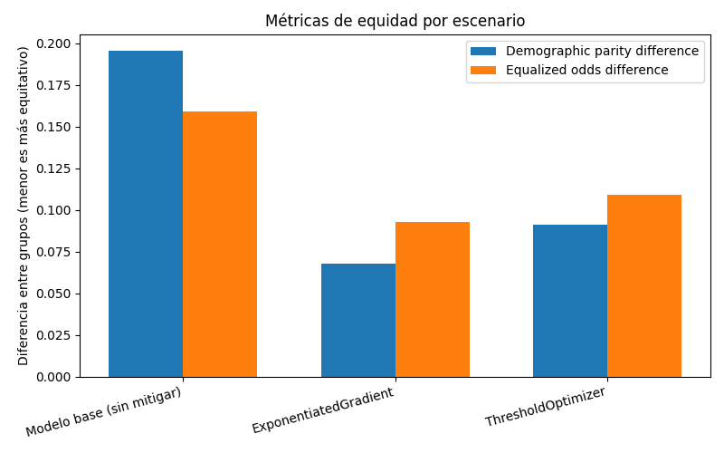
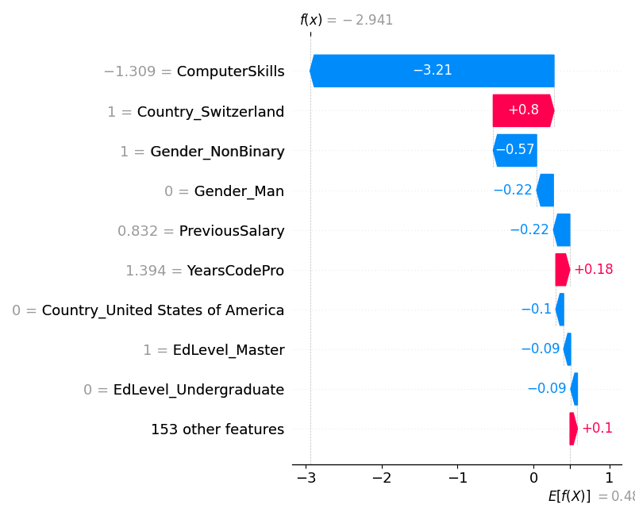
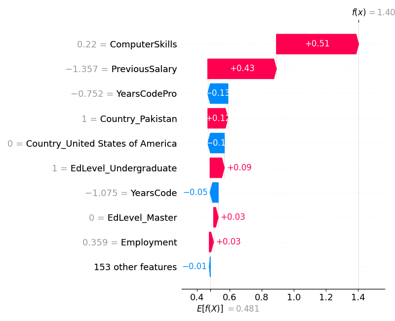
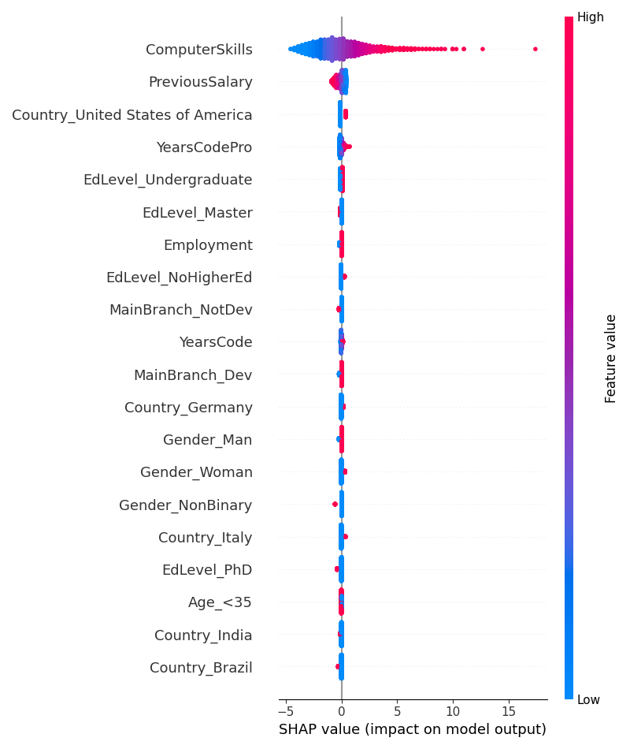

# Evidencias — Auditoría de equidad, mitigación y explicabilidad

_Generado automáticamente el 2026-10-17 05:11._

## Configuración de la corrida

- **Dataset:** data/job_applicants_limpio.csv
- **Columna objetivo:** `Employed` (clase positiva: `1`)
- **Atributo sensible:** `Gender`
- **Método de mitigación:** `ambos`
- **Restricción de equidad:** `equalized_odds`

## Auditoría de equidad — modelo base (pre-mitigación)

- **Exactitud global:** 0.788
- **Demographic parity difference:** 0.195
- **Equalized odds difference:** 0.159
- **demographic_parity_ratio:** 0.630
- **equalized_odds_ratio:** 0.351

### Métricas por grupo

| Grupo | Exactitud | Tasa de selección |
|---|---|---|
| Man | 0.790 | 0.529 |
| NonBinary | 0.792 | 0.333 |
| Woman | 0.761 | 0.472 |

> TODO estudiante: interpretá esta tabla vinculándola con el sesgo documentado en el caso real analizado en la consigna 3 (¿el patrón que ves acá es consistente con lo que reportó el caso?).

## Comparación antes / después de la mitigación

| Escenario | Exactitud | Demographic parity diff. | Equalized odds diff. |
|---|---|---|---|
| Modelo base (sin mitigar) | 0.788 | 0.195 | 0.159 |
| ExponentiatedGradient | 0.783 | 0.091 | 0.052 |
| ThresholdOptimizer | 0.776 | 0.099 | 0.129 |

> TODO estudiante: discutí qué tan efectiva resultó la mitigación aplicada y qué limitaciones observaste (consigna 9.c) — por ejemplo, si mejoró la equidad pero bajó la exactitud, o si algún escenario no logró reducir la disparidad.

## Explicabilidad (SHAP) — modelo base

SHAP se aplica siempre sobre el modelo base, antes de cualquier mitigación: el objetivo es ver qué técnica de auditoría preventiva podría haber detectado el problema antes del despliegue (consigna 4).

### Predicción 23 — el atributo sensible más influyó

- Contribución absoluta de `Gender`: 0.806
- Predicción del modelo: 0 · Valor real: 0

### Predicción 0 — el atributo sensible casi no influyó

- Contribución absoluta de `Gender`: 0.048
- Predicción del modelo: 1 · Valor real: 1

### Resumen global

> TODO estudiante: vinculá esta evidencia con la consigna 4 — ¿SHAP sobre el modelo base hubiera permitido detectar este problema antes del despliegue?
