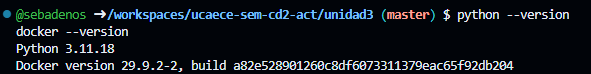
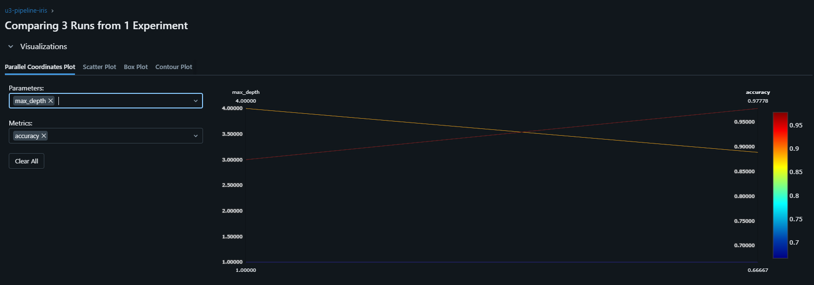
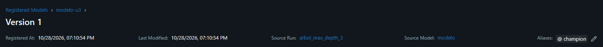
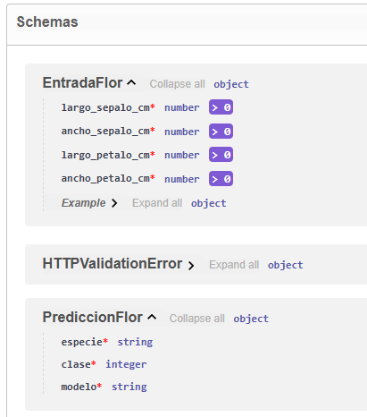
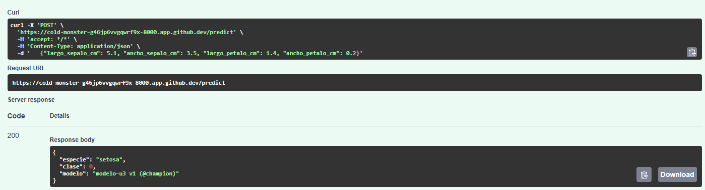
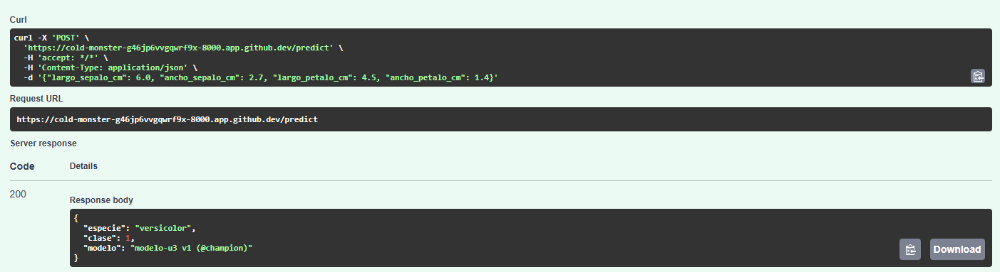
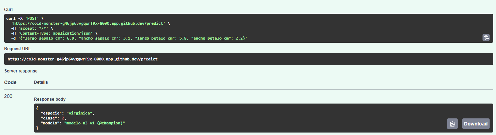
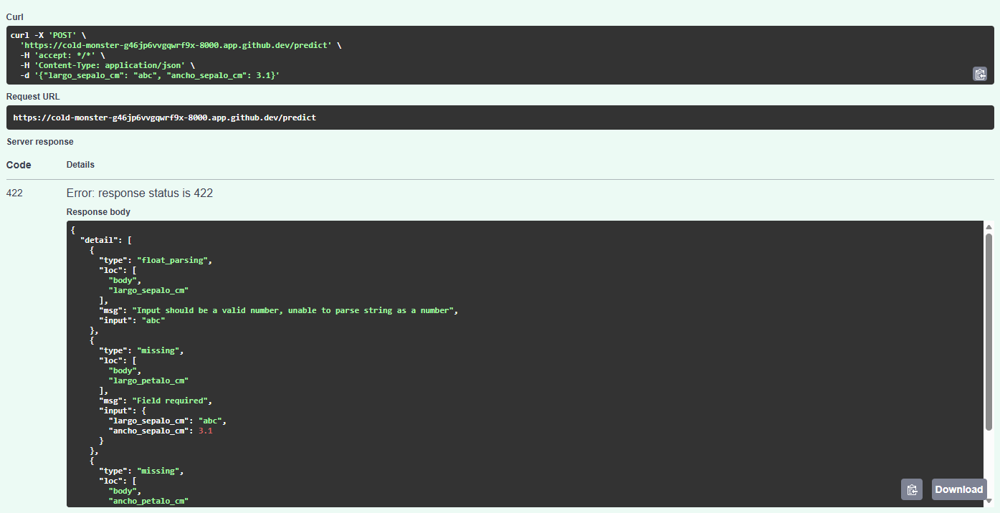
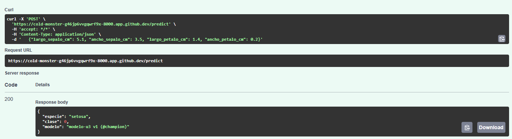
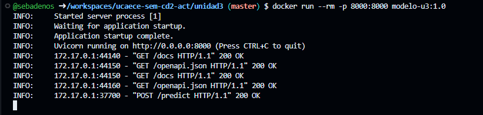

# Resultados — Unidad 3: MLOps/LLMOps

**Estudiante:** Sebastián Losinno
**Fecha:** 28/10/2026

---

## Consigna 6: Preparación del entorno

Fork sincronizado con la plantilla de la cátedra (**Sync fork**) y Codespace creado con la
configuración `unidad3-seminario-cd2` (Python 3.11 y Docker instalados automáticamente).



---

## Consigna 7: Experimentación y registro con MLflow

| Corrida | max_depth | accuracy | f1_macro |
|---------|-----------|----------|----------|
| arbol_max_depth_1 | 1 | 0.667 | 0.556 |
| arbol_max_depth_3 | 3 | 0.978 | 0.978 |
| arbol_max_depth_4 | 4 | 0.889 | 0.889 |

**Versión registrada:** modelo-u3 v1 (@champion), corrida con max_depth = 3

Salida de consola:

```
Corrida registrada: max_depth=1 · accuracy=0.667 · f1_macro=0.556
Corrida registrada: max_depth=3 · accuracy=0.978 · f1_macro=0.978
Corrida registrada: max_depth=4 · accuracy=0.889 · f1_macro=0.889
Registrado modelo-u3 versión 1 con alias @champion (corrida arbol_max_depth_3, accuracy=0.978)
```





> Con max_depth = 1 el árbol hace una sola pregunta: separa setosa del resto pero nunca
> predice una de las otras dos especies, por eso la accuracy cae a 0,667 y el F1 macro a
> 0,556. Con max_depth = 3 llega a 0,978 en ambas métricas, y con max_depth = 4 baja a
> 0,889: más profundidad no implica generalizar mejor (sobreajuste). Registrar todas las
> corridas, incluso las peores, deja trazabilidad de qué se probó y por qué se eligió la
> versión @champion, evita repetir experimentos y permite reproducir o revertir cualquier
> resultado: es lo que justifica usar MLflow (tracking + Model Registry) en la consigna 2.

---

## Consigna 8: Serving con FastAPI

Contrato de `POST /predict` (ver `/docs`): recibe un JSON con cuatro números obligatorios
y mayores que cero (`largo_sepalo_cm`, `ancho_sepalo_cm`, `largo_petalo_cm`,
`ancho_petalo_cm`) y devuelve `especie` (texto), `clase` (entero 0 a 2) y `modelo` (versión
que respondió). Si la entrada no cumple el contrato, responde HTTP 422.

| Entrada | Respuesta de la API |
|---------|---------------------|
| `{"largo_sepalo_cm": 5.1, "ancho_sepalo_cm": 3.5, "largo_petalo_cm": 1.4, "ancho_petalo_cm": 0.2}` | 200 · `{"especie": "setosa", "clase": 0, "modelo": "modelo-u3 v1 (@champion)"}` |
| `{"largo_sepalo_cm": 6.0, "ancho_sepalo_cm": 2.7, "largo_petalo_cm": 4.5, "ancho_petalo_cm": 1.4}` | 200 · `{"especie": "versicolor", "clase": 1, "modelo": "modelo-u3 v1 (@champion)"}` |
| `{"largo_sepalo_cm": 6.9, "ancho_sepalo_cm": 3.1, "largo_petalo_cm": 5.8, "ancho_petalo_cm": 2.2}` | 200 · `{"especie": "virginica", "clase": 2, "modelo": "modelo-u3 v1 (@champion)"}` |
| `{"largo_sepalo_cm": "abc", "ancho_sepalo_cm": 3.1}` | 422 · `largo_sepalo_cm`: "Input should be a valid number"; `largo_petalo_cm` y `ancho_petalo_cm`: "Field required" |











> La API valida la entrada con Pydantic antes de llamar al modelo: como "abc" no es un
> número y faltan dos campos, responde HTTP 422 con el detalle de cada error y el dato
> nunca llega al modelo. En producción la API recibe datos de otros sistemas que pueden
> fallar o cambiar de formato; validar el contrato evita predicciones basura que pasarían
> inadvertidas o errores 500 sin explicación, le indica al consumidor exactamente qué
> corregir y deja un error registrable que alimenta el monitoreo.

---

## Consigna 9: Containerización con Docker

Imagen `modelo-u3:1.0` construida con el `Dockerfile` provisto (`docker build -t modelo-u3:1.0 .`)
y ejecutada con `docker run --rm -p 8000:8000 modelo-u3:1.0`. La predicción contra la API
del contenedor devuelve la misma respuesta que la API local.





> La imagen es inmutable y lleva adentro su propio modelo (el campo `modelo` de cada
> respuesta identifica la versión). Con una `modelo-u3:1.1`, la estrategia canary de la
> consigna 3 consistiría en levantar réplicas de la 1.1 detrás del mismo balanceador que
> la 1.0 y enviarles primero un 5–10 % del tráfico; si la tasa de error, la latencia y la
> calidad se mantienen, se sube el porcentaje hasta el 100 % y se retira la 1.0. Si algo
> empeora, el rollback es inmediato: volver a mandar todo el tráfico a la etiqueta 1.0.

---

## Paso opcional: LLMOps con Groq

No realizado (paso opcional, sin puntaje).